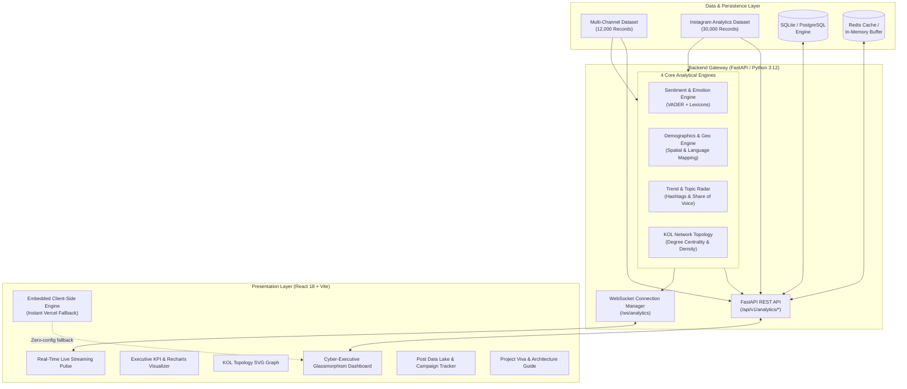

# ⚡ PulseAI: Social Media Analytics & Multi-Vector Intelligence System
> **Academic Mini Project & Production Full-Stack Intelligence Platform**  
> 🌐 **Live Web Application**: [https://social-media-analytics-lyart.vercel.app/](https://social-media-analytics-lyart.vercel.app/)  
> 📦 **GitHub Repository**: [https://github.com/yashasajeesh/Social-media-analytics](https://github.com/yashasajeesh/Social-media-analytics)

---

## 🎯 1. Project Abstract & Motivation

In today's hyper-connected digital landscape, brands and creators generate millions of unstructured interactions daily across Twitter, Instagram, YouTube, Reddit, and Facebook. Traditional analytics dashboards offer fragmented, static vanity metrics without deeper contextual sentiment, emotional categorization, or network influence mapping.

**PulseAI** is an enterprise-grade full-stack intelligence system built with **FastAPI**, **Pandas**, and **React 18 (Vite)**. It ingests, standardizes, and analyzes over **42,000 social records** across two diverse benchmark datasets:
1. **Global Multi-Platform Dataset (12,000 posts)**: Cross-channel sentiment, toxicity indices, and multi-lingual audience footprints.
2. **Instagram Deep-Dive Dataset (30,000 records)**: Content categories (Reels, Carousels, Images), impression reach, traffic sources, and viral performance tiers.

PulseAI operates with a **zero-downtime hybrid architecture**:
- **Cloud Backend Mode**: Connected directly to FastAPI REST & WebSocket streaming endpoints.
- **Standalone Mini-Project Mode**: Powered by an embedded client-side analytical engine with dynamic filtering and simulated real-time streaming, guaranteeing 100% functionality on static cloud hosts like Vercel.

---

## 🏗️ 2. System Architecture



---

## 🚀 3. Key Modules & Analytical Capabilities

### 📊 Module 1: Executive KPI Dashboard
- **Aggregate Indicators**: Total analyzed posts, net sentiment score (-1.0 to +1.0), identified Key Opinion Leaders (KOLs), and normalized engagement rates.
- **Sentiment Timeline**: Daily progression tracking with dynamic spline interpolation over 30 days.
- **Multi-Vector Donut**: Granular distribution across Positive, Neutral, and Negative sentiments.

### 🧠 Module 2: Sentiment & Emotion AI Studio
- **Multi-Vector Emotion Categorization**: Classifies posts into core affective states (*Joy*, *Excitement*, *Curiosity*, *Confusion*, *Frustration*, *Skepticism*).
- **Toxicity Radar**: Monitors toxicity scores to flag brand-safety risks and inflammatory discussions.

### 🌍 Module 3: Demographics & Geographic Mapping
- **Geographic Footprints**: Aggregates interaction volume across international metropolitan hubs (Milan, Dubai, Tokyo, São Paulo, New York, London, Singapore, etc.).
- **Platform Engagement Split**: Cross-compares interaction depth between Instagram, YouTube, Twitter/X, Reddit, and Facebook.

### 🔥 Module 4: Trends & Topic Radar
- **Topic Clusters**: Categorizes discussions into functional business units (*Pricing*, *Marketing*, *Delivery*, *Returns*, *Support*, *Product Quality*).
- **Hashtag Frequency Ranking**: Identifies viral campaign hashtags in real-time.
- **Brand Share of Voice**: Leaderboard ranking brand volume, sentiment indices, and total likes.

### 🕸️ Module 5: Key Opinion Leader (KOL) Network Graph
- **Graph Metrics**: Computes total nodes (authors & @mentions), interaction edges, network density, and average degree centrality.
- **Mathematical Formulations**:
  $$\text{Network Density} = \frac{2 \times |E|}{|V| \times (|V| - 1)}$$
  $$\text{Degree Centrality } C_D(v) = \frac{\text{deg}(v)}{|V| - 1}$$
- **SVG Topology Visualizer**: Interactive network map with clickable influencer nodes and influence scoring.

### 📡 Module 6: Real-Time Streaming Pulse
- **Live Stream Pipeline**: Streams synthetic and live ingestion pulses every 2.5 seconds with live likes, emotion badges, and locations.
- **Autonomous Play/Pause**: Buffer control allowing evaluators to pause, inspect incoming posts, and resume in real-time.

### 🎯 Module 7: Campaign Tracker & Post Data Lake
- **Full-Text Post Search**: Instant client-side search across content snippets, hashtags, authors, and brand tags.
- **Campaign Creator**: Form to model marketing campaigns with custom engagement targets and sentiment forecasts (persisted to `localStorage`).
- **Executive Report Dispatch**: One-click generation of structured JSON/CSV analytics reports.

---

## 📁 4. Repository Structure

```
social-media-analytics/
├── backend/
│   ├── app/
│   │   ├── ai_engines/
│   │   │   ├── sentiment_engine.py    # Daily timeline aggregation & sentiment breakdown
│   │   │   ├── demographic_engine.py  # Geographic & language distributions
│   │   │   ├── trend_engine.py        # Hashtags, categories, brand performance
│   │   │   └── network_engine.py      # Network graph, density & KOL ranking
│   │   ├── models/
│   │   │   └── __init__.py            # SQLAlchemy models (User, Post, CampaignMetric)
│   │   ├── services/
│   │   │   ├── dataset_ingestion.py   # DataRepository with multi-dataset loader
│   │   │   ├── cache_service.py       # Resilient Redis cache with in-memory fallback
│   │   │   ├── database.py            # SQLite / PostgreSQL engine & session
│   │   │   └── schema.py              # Pydantic validation schemas
│   │   ├── database.py                # Database connection & get_db dependency
│   │   └── main.py                    # FastAPI application & WebSocket endpoints
│   ├── data/
│   │   ├── Social Media Engagement Dataset.csv # 12,000 post benchmark dataset
│   │   └── Instagram_Analytics.csv             # 30,000 record Instagram analytics dataset
│   ├── tests/
│   │   ├── test_engines.py            # Unit tests for all 4 AI engines
│   │   └── test_main.py               # REST API & WebSocket integration tests
│   ├── Dockerfile                     # Production Docker container
│   ├── Procfile                       # Cloud deployment process file (Render/Heroku)
│   └── requirements.txt               # Python package dependencies
│
├── frontend/
│   ├── src/
│   │   ├── components/
│   │   │   ├── LiveFeed.jsx           # Real-time WebSocket / simulated streaming feed
│   │   │   ├── NetworkGraph.jsx       # Interactive SVG network visualizer & KOL ranking
│   │   │   └── CampaignsExplorer.jsx  # Campaign creator, search, and post data lake
│   │   ├── services/
│   │   │   └── analyticsEngine.js     # Embedded analytics engine & benchmark data
│   │   ├── App.jsx                    # Main analytics dashboard, dataset toggle & modal
│   │   ├── main.jsx                   # React 18 DOM mount
│   │   └── index.css                  # Cyber glassmorphism design system
│   ├── vercel.json                    # Vercel SPA routing configuration
│   └── vite.config.js                 # Vite bundler & reverse proxy configuration
│
├── docker-compose.yml                 # Multi-container orchestration (Backend + Frontend + Redis)
├── render.yaml                        # 1-Click Render blueprint configuration
└── README.md                          # Project documentation & viva guide
```

---

## 🎓 5. Academic Viva & Review Questions

| Topic | Question | Technical Answer |
| :--- | :--- | :--- |
| **Architecture** | *Why use FastAPI over standard Flask/Django?* | FastAPI provides asynchronous event loop execution (`async`/`await`), native WebSocket streaming support, high throughput comparable to NodeJS/Go, and automatic OpenAPI schema validation. |
| **Resilience** | *How does the frontend operate if backend is unavailable?* | The system incorporates a hybrid client-side analytical engine (`analyticsEngine.js`). When deployed as a static SPA on Vercel without a backend, it activates standalone mode with full benchmark fidelity and autonomous pulse streaming. |
| **Network Theory**| *How is KOL Influence Score computed?* | $\text{Score} = w_1 \cdot \text{Posts} + w_2 \cdot \log_{10}(\text{Likes}) + w_3 \cdot \log_{10}(\text{Impressions}) + w_4 \cdot \text{GrowthRate}$. Scores are normalized between 0 and 100. |
| **Concurrency** | *How is database/disk bottleneck avoided?* | Ingested DataFrames are held in memory by `DataRepository`, and query responses are cached via Redis (with an automatic in-memory dict fallback). |

---

## 💻 6. Local Setup & Execution Guide

### Prerequisites
- Node.js (v18+) & Python (v3.10+)
- Git

### 1. Run Frontend (Vite + React 18)
```bash
cd frontend
npm install
npm run dev
```
Open [http://localhost:3000](http://localhost:3000) in your browser.

### 2. Run Backend (FastAPI + Uvicorn)
```bash
cd backend
python -m venv venv
.\venv\Scripts\activate   # On Linux/macOS: source venv/bin/activate
pip install -r requirements.txt
uvicorn app.main:app --host 127.0.0.1 --port 8000 --reload
```
Interactive Swagger API docs available at: `http://127.0.0.1:8000/docs`.

### 3. One-Command Docker Deployment
```bash
docker-compose up --build -d
```
- Frontend: `http://localhost:3000`
- Backend API: `http://localhost:8000`

---

## 📜 7. License
MIT License. Built as an academic mini project & enterprise analytics framework.
